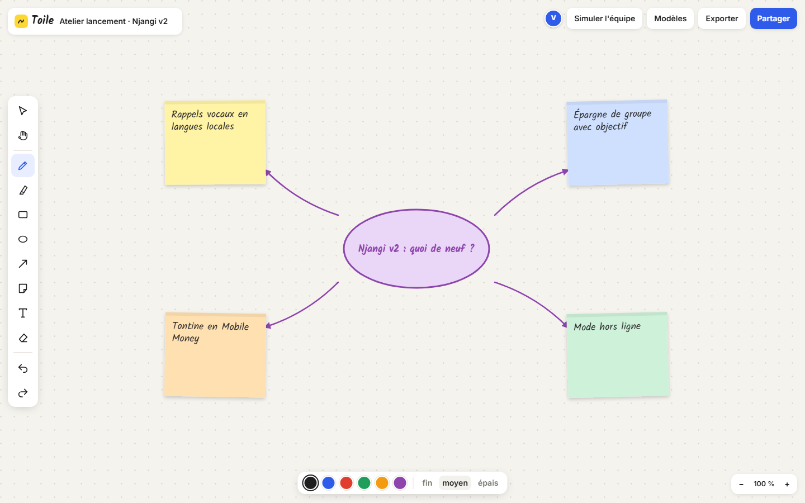
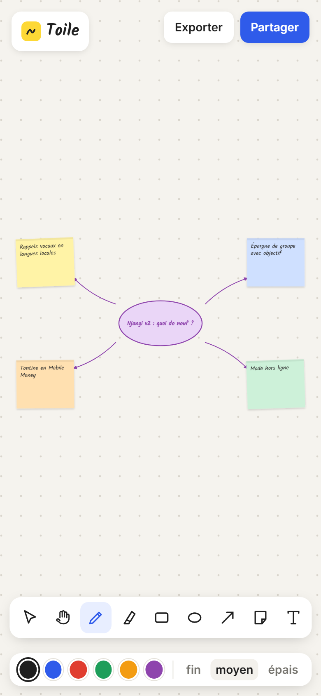

# Toile

**Tableau blanc collaboratif** — Tableau blanc en ligne pour les ateliers d'équipe : dessin à main levée lissé, surligneur, rectangles, ellipses, flèches courbes, post-it manuscrits, texte libre, sélection et déplacement, gomme, annuler et rétablir, zoom et déplacement infinis. Les onglets ouverts se synchronisent en temps réel avec curseurs nommés, et des modèles prêts à l'emploi lancent une rétrospective, un brainstorming ou un parcours client.

**Démo en ligne : [https://lordlennyx.github.io/toile-tableau-blanc/](https://lordlennyx.github.io/toile-tableau-blanc/)**

Spot de présentation (30 s) : [media/spot-30s.mp4](https://lordlennyx.github.io/toile-tableau-blanc/media/spot-30s.mp4)

## Ce que le projet montre

- Outils de dessin : crayon lissé, surligneur, rectangle, ellipse, flèche courbe, texte, gomme
- Post-it manuscrits en six couleurs, signés par leur auteur, éditables au double clic
- Toile infinie : zoom à la molette ou au pincement, déplacement à la main ou à la barre d'espace
- Collaboration en temps réel entre onglets (BroadcastChannel) avec curseurs nommés
- Modèles d'atelier : rétrospective, brainstorming, parcours client
- Historique annuler/rétablir, raccourcis clavier, sauvegarde locale, export PNG haute définition

## Réalisation

- **Stack :** HTML, CSS, JavaScript natif, SVG, BroadcastChannel
- **Typographies :** Kalam, Inter
- **Évolutions possibles :** synchronisation multi-appareils par WebSocket ou CRDT (Yjs), votes à points, minuteur d'atelier, import d'images et de PDF

| Bureau | Mobile |
|---|---|
|  |  |

---

Client et contenus fictifs, créés pour la démonstration. Conception, design et développement : **Njundiyimun Béchard** — [github.com/LordLennyx](https://github.com/LordLennyx)
